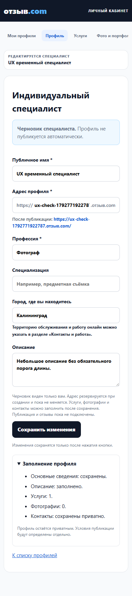
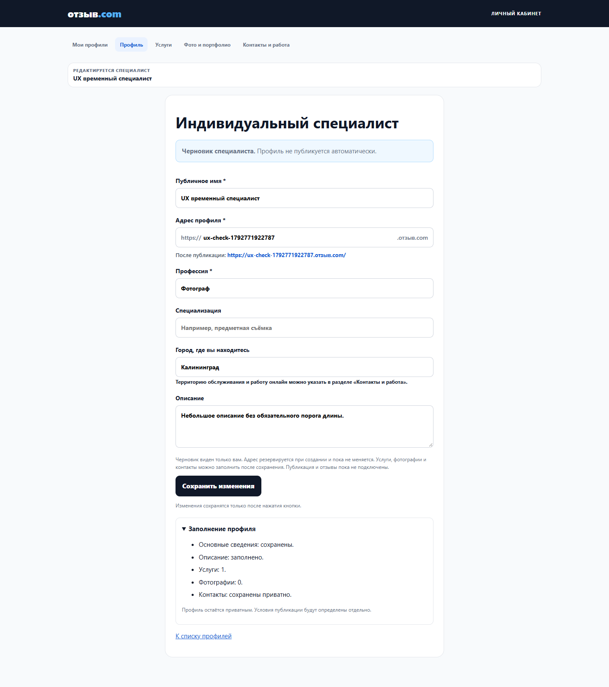

# Saved profile overview

Continuation after owner “Продолжай”, decision 5a7b311d. Base PR33 2fd81f07bf30aced6d47c1e84a9182ef3232c2e7.

A collapsed “Заполнение профиля” details block shows only saved facts. Before creating a profile it says to save first and makes no data RPC. After authenticated owner draft load or confirmed Save, independent existing reads retrieve services/media/settings/channels. Description status uses the confirmed saved value, not unsaved input. Read errors and malformed payloads are unknown, not zero/missing. Contacts are a presence indicator; values are not copied into the overview. No counts are used to permit/deny Save or publication. No percentages, thresholds, mandatory photos/contact, verification badges or publish action. The block states that the profile remains private and publication rules will be defined separately.

Only specialist HTML/helpers/CSS and tests change; no SQL/RPC/ACL/workflow changes. No new public build asset. Existing five-link navigation and company files remain unchanged. Qualifications remain in the prior form and use the prior settings contract; the proposal to relocate them is separate.

Validation: expanded SQL-backed UX groups check no pre-create reads, collapsed state, saved versus unsaved description, real counts, private-contact presence without values, independent partial read failures, and editor availability without writes. Existing profile/company/channel regressions retained. Actual hosted runner checks counts from its temporary draft/service/settings and cleans the fixture through the existing owner RPC. 390/1440 layout and screenshots are captured separately.

This implements the informational part of the earlier readiness proposal; it does not implement publication readiness rules. Future changes need explicit decisions about publication and editing published profiles.

Evidence: source3aa783b preview8402d89a passed 9 actual hosted groups, including real saved-data overview,390/1440,zero page errors and fixture cleanup. Local8UX+9contact+12previousbrowser+Pages60 PASS; PostgreSQL channel and expanded browser CI PASS. The screenshots below contain only the temporary synthetic profile, now deleted. No publication or working-site change.

