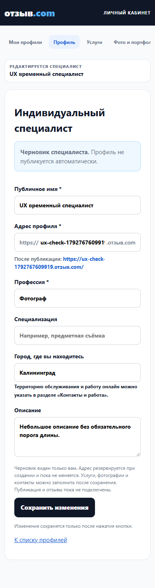
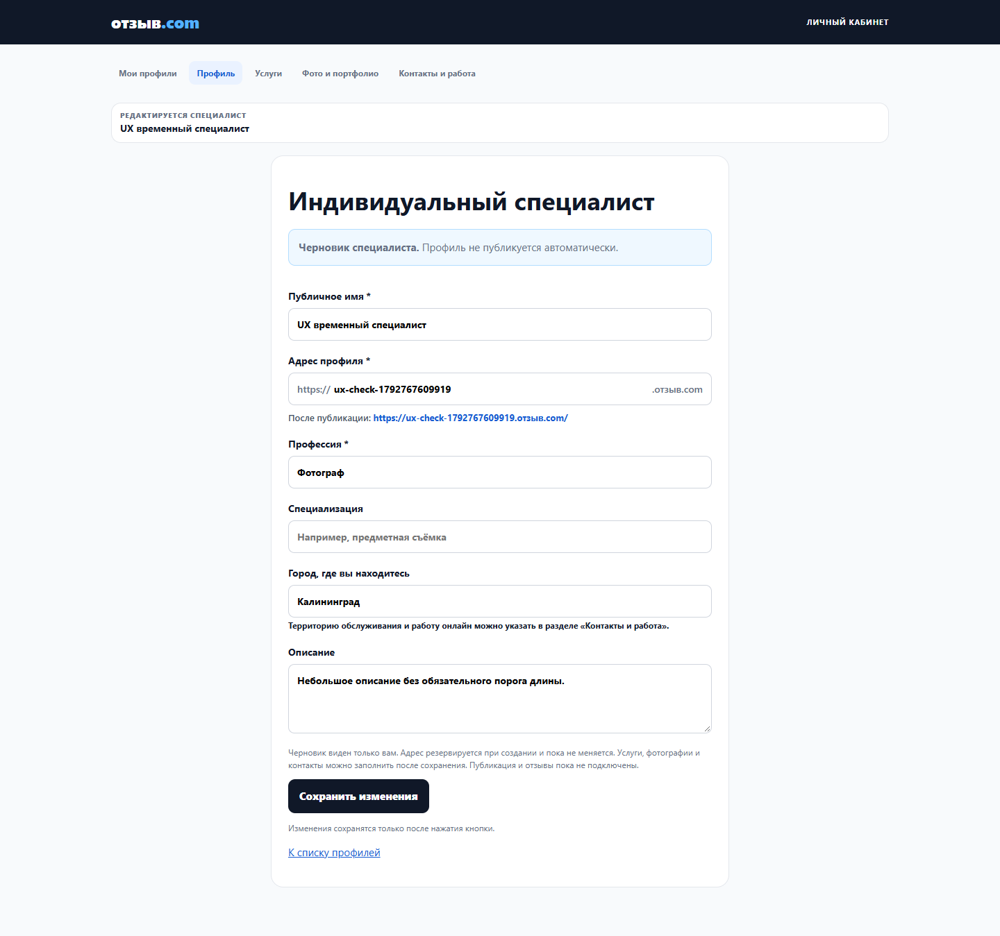
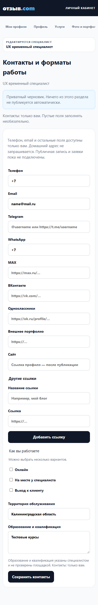

# Specialist UX polish — REQUEST 24b6b51e / 4c6befcf

Base: PR32 9b3d2d829e30a00852a6773a0cff8e2684deaa42. This PR adds only specialist UX changes; company, schema, RPCs, ACL, navigation structure, workflows, main and production are excluded.

## Scope against the actual base

| Request | Base behavior | Result |
| --- | --- | --- |
| Stay after Save | Profile creation/update redirected to dashboard | Confirmed Save remains in editor. Creation changes URL to saved id and switches to update mode, locks slug and renders existing five-link navigation. Explicit “К списку профилей” remains. |
| Field errors/focus | Native constraints without persistent indication; profile and price range errors generic | Specialist-only validation helpers add aria-invalid, visible border, first-invalid focus/native message. Profile name/address/profession, service range/name/duration, contact email and photo file format are covered. No server error is falsely attributed to a field without evidence. |
| Helpful wording | No service description guidance; photo format explanation incomplete | Description prompt explains contents/preparation/result. Duration explicitly optional. Photo guidance distinguishes 20MB source/5MB processed and HEIC-to-JPEG. Caption asks task/work/result, remains optional. |
| Qualifications | In settings RPC/form with contact fields | Kept in place; risk analysis and concrete proposal below. Self-declared/unverified wording clarified. |
| City vs geography | Similar wording | Profile: “Город, где вы находитесь”; contacts: “Территория обслуживания”, multiple cities/areas. Both data fields retained. |
| Read-only readiness | No approved publication minimum or public specialist contract | Design proposal below; no readiness score, publication gate or new business rule shipped. |

## Qualifications relocation: proposal, not silent move

The current get/save_my_specialist_settings RPC reads/writes phone, email, website, work_formats, service_area and qualifications with one aggregate version. update_my_specialist_draft does not accept qualifications. Moving the textarea alone would either lose its submitted value or create a second writer of the whole settings aggregate.

Safe future implementation without SQL could load the settings aggregate in Profile, keep it isolated from profile save, and offer a clearly separate “Сохранить образование” action. Submit the original unrelated values plus edited qualifications and the original version; reject stale writes and require reload rather than silently merge. Missing settings RPC disables only that subsection. Remove its contact editor only after roundtrip/stale/partial-load tests prove preservation. This increases UI complexity and changes the approved simple form, so this PR leaves the existing field intact. A unified profile Save would still be two non-atomic RPCs; do not promise one transaction or overwrite new contacts with cached values.

## Proposed read-only “Готовность к публикации”

Placement: a collapsed details block below the profile form. No new menu, percent, traffic light, “publishable” claim or publish button. Only facts from saved owner data, e.g.:
- “Основные сведения сохранены” / “Описание не заполнено”.
- “Услуги: N”; “Фотографии: N”.
- “Контакты сохранены приватно” (no public-channel requirement).
- Footer: “Профиль остаётся приватным. Условия публикации будут определены отдельно.”

Sources: get_my_specialists plus existing owner service/media/settings/channel RPCs. Count text only, no contact values copied into an overview. Independent read errors show “Не удалось проверить” rather than a missing-data penalty. Newly created unsaved form shows “Сначала сохраните профиль”. Refresh after confirmed Save, no writes or third-party requests. Changing rules or exposing contacts is outside this view.

Decisions still needed: publication contract including editing published profiles; exact readiness criteria (if any); whether this informational block belongs on Profile or a future publication screen. A 100-character description, photo minimum and public channel are suggestions from audit, not approved requirements. Therefore this PR documents the block instead of implementing an arbitrary gate.

## Validation and operational notes

Local UI acceptance uses isolated SQL and simulated Auth/Storage, with all external traffic blocked. New tests/specialist-ux-browser.mjs is invoked from the existing channel-browser acceptance entry point; no workflow edits. Existing create/edit browser expectations are updated to the approved stay-in-editor behavior. Hosted checks are separate and restore original test data using version checks; synthetic draft creation must be explicitly cleaned up.

PR is stacked on PR32. Existing channel CI runs only for main/PR31 integration base; do not claim an absent PR32-base trigger ran. An integration run may be requested using the already-enabled PR31 base before retargeting the Draft PR to PR32, with source SHA and run/base recorded. Never trigger pages.yml (would publish the working site).

No SQL applied. No education values moved. No readiness business rules or publication implemented.

## Evidence and verified result

- Local: 6 new UX groups, 9 contact browser groups, 12 existing browser groups, 9 editor security groups, 13 specialist acceptance groups, 9 channel security/model groups and Pages60 PASS. Single-session PGlite does not prove overlapping SQL transactions; existing PostgreSQL channel CI covers that separately.
- Actual staging/Edge: 8 UX groups PASS, including actual create -> remain -> update -> reload, explicit return, focused invalid service/email/file fields, service/contact persistence, distinct city/territory and preserved qualifications. Temporary draft, service and settings were removed through the existing owner delete RPC after a no-op cleanup-endpoint preflight. Original account profiles unchanged.
- Existing actual hosted contacts: 12 groups PASS, including named links, metadata/private roundtrip, invalid rejection, 320/390/1440 and CAS restoration of original settings/channels. No uploads or production requests from the new UX test.
- 33 company/legacy account Git blobs and checkout bytes unchanged; no SQL or workflow files changed.
- Screenshots below contain only synthetic test values, captured from source41eee63 previewd2efe9f5; the later service edit-validation reset does not change these profile/contact views. The temporary profile shown has been deleted, not published.

The full disposable Docker Supabase stack was not rerun in this Windows session; its browser expectations were aligned with the new stay-in-editor behavior and syntax-checked. Actual hosted Auth/PostgREST checks and isolated SQL/browser tests are separate evidence; no claim of a new full Docker stack run.
